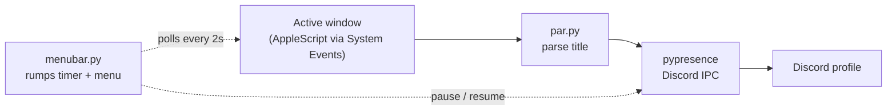

<div align="center">

<picture>
  <source media="(prefers-color-scheme: dark)" srcset="images/githublogowhite.png">
  <source media="(prefers-color-scheme: light)" srcset="images/githublogodark.png">
  
</picture>

<br>

**See what your friends are working on, not just what they're playing.**

A lightweight macOS menu bar app that turns your active window into a Discord Rich Presence status.

<br>


</div>

<br>

<!-- Add a screenshot of the Discord status + menu bar here, e.g.:
<p align="center"></p>
-->

## What it does

Most Discord presence tools stop at games and Spotify. PSPresence shows the work itself, so friends and collaborators can see what you're actually doing.

- **Detects your active app and window** using AppleScript, with no screen recording or extra system access.
- **Turns raw window titles into readable status**, for example `Editing main.py` instead of a long editor title.
- **Updates Discord only when something changes**, and reconnects on its own if Discord restarts.
- **Lives in the menu bar** with a live status line, a one-click pause, and an About window.

| Menu item | What it does |
| --- | --- |
| Status line | Shows exactly what is being shared right now |
| Pause / Resume sharing | Clears your Discord status immediately and stops updates until resumed |
| About | Opens the About window |
| Quit | Clears your status, then exits |

## How it works



| File | Role |
| --- | --- |
| `presence.py` | Window detection and the Discord connection (also runnable on its own in the terminal) |
| `par.py` | Turns app names and window titles into the two lines shown on Discord |
| `menubar.py` | The menu bar app that ties everything together |

**Built with:** Python 3.14, [uv](https://docs.astral.sh/uv/), [pypresence](https://github.com/qwertyquerty/pypresence), [rumps](https://github.com/jaredks/rumps), AppleScript via `subprocess`.

## Getting started

**Requirements**

- macOS
- Discord desktop app, running
- Python 3.14 and [uv](https://docs.astral.sh/uv/)
- Accessibility permission for your terminal (System Settings → Privacy & Security → Accessibility). Without it, window titles come back empty.

**Run it**

```bash
git clone https://github.com/EastExtra/PSpresence.git
cd PSpresence
uv sync
uv run menubar.py
```

A logo appears in your menu bar and your Discord status starts updating. To run without the menu bar, use `uv run presence.py` and stop it with Ctrl+C.

**Using your own Discord app:** create one in the Discord Developer Portal and replace `CLIENT_ID` in `presence.py`. The client ID is a public identifier, not a secret.

## Privacy

> [!WARNING]
> Window titles are shown **publicly** on your Discord profile. Browser tabs, email subjects and chat names can all appear. Use **Pause sharing** before opening anything private. App allowlisting and title redaction are the top roadmap items for this reason.

## Engineering notes

- **AppleScript instead of a cross-platform library.** PyGetWindow's macOS support is largely unimplemented, so PSPresence asks System Events directly for the frontmost app and its window title.
- **Change-driven updates.** Presence is only pushed when the window actually changes, not on every poll.
- **Resilient connection.** If Discord isn't running yet or the connection drops, the app reconnects on the next tick instead of crashing.
- **Non-blocking by design.** Polling runs on a `rumps` timer rather than a sleep loop, so the menu stays responsive. Retries happen on the next tick instead of blocking.
- **Small, separable modules.** Detection, title parsing and UI live in separate files, which keeps each piece testable and replaceable.

## Roadmap

- [x] Active app and window detection
- [x] Discord Rich Presence with auto-reconnect
- [x] Readable title parsing
- [x] Menu bar app with pause / resume
- [ ] App allowlist and title redaction
- [ ] Smarter filename detection in browsers
- [ ] Update throttling to respect Discord's rate limit
- [ ] Music and video detection (a terminal prototype for video detection works)
- [ ] Idle detection
- [ ] Packaged `.app` with launch at login

**Known limitations:** filename detection can misfire on browser titles that contain version numbers, and window titles are sent unfiltered for now (see Privacy).

## Author

Built by [@EastExtra](https://github.com/EastExtra).